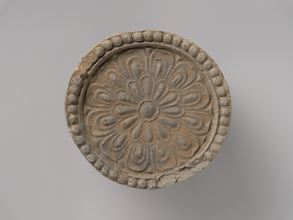
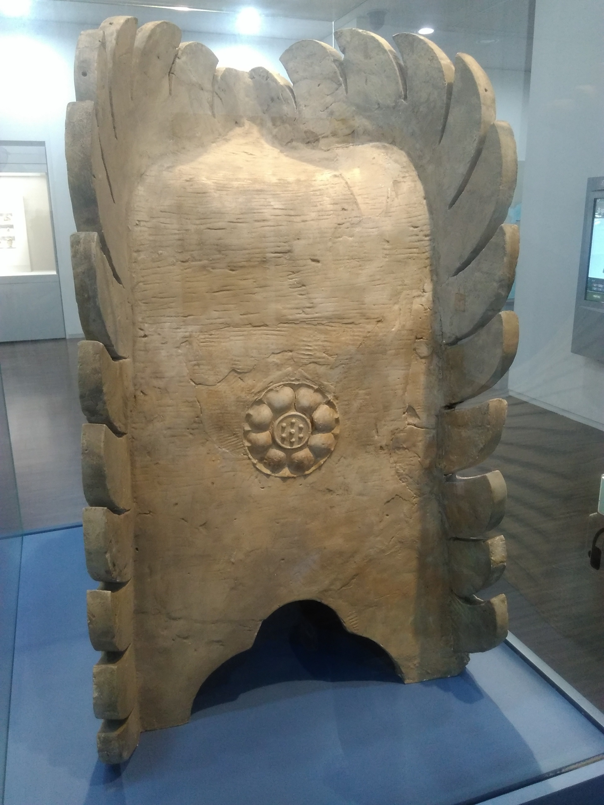
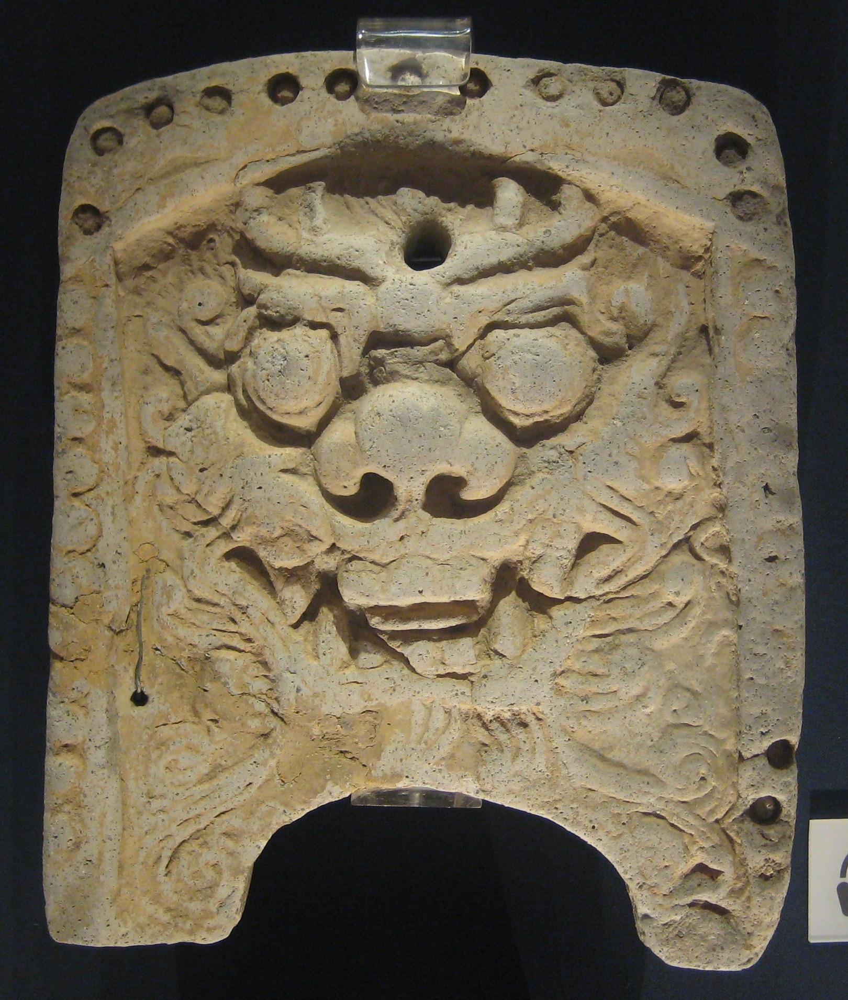
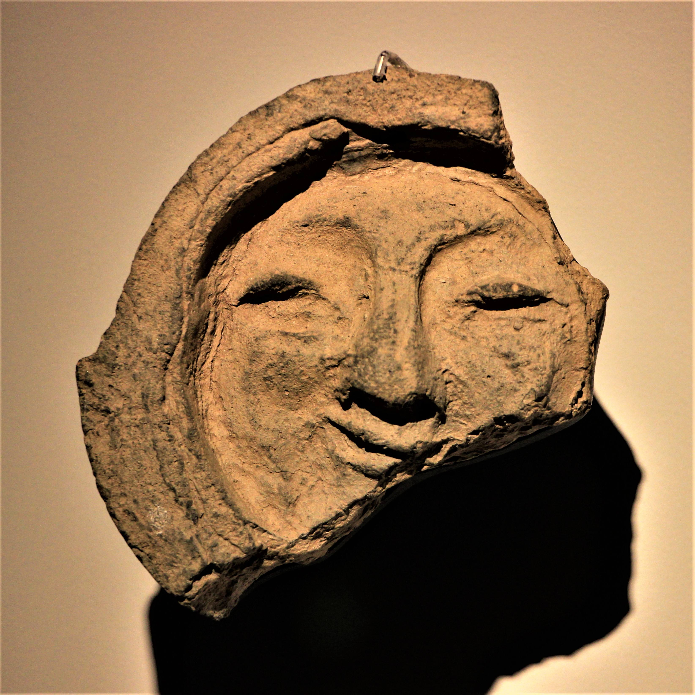

A round clay face peeks out beneath a roof. Its pattern may catch the eye first, but the more useful first question is where the piece belongs: at the edge of a roof tile, on a wooden rafter, or up at the ridge?

These are different positions, not interchangeable names for every decorated piece. The museum examples below give a way to sort the clues without claiming that every old roof followed one design.

<strong>Editorial method:</strong> AI assisted the research and drafting; the evidence-gated editorial process checked the cited sources, and manual review remains pending.

The cover is an AI-generated editorial still life, not a photograph of a historical object. The four credited photographs below are separate source images. They help compare shapes, but a photograph alone cannot establish where an undocumented fragment was installed.

<h3>At the eaves: follow the water</h3>

In its record for an excavated Mireuksa example, the Smithsonian explains that round tile ends capped convex roof tiles at the eaves above the rafters and were intended to direct water off the roof.

That record is especially helpful because the curved tile remains attached to its decorated end. The attachment gives the pattern a place in the roof assembly rather than leaving it as a free-floating symbol. A round face by itself may look familiar; the surviving connection tells a more specific story.

The Met identifies the separate object below as a Korean roof end tile. Its collection label is useful evidence for that object, not evidence that it was part of the same roof as the Smithsonian example.

<figure class="post-photo source-image"><figcaption>The Metropolitan Museum of Art, Gift of Mrs. Charles H. Sheldon, 1960, 60.130.3. Public domain. Source: <a href="https://collectionapi.metmuseum.org/public/collection/v1/objects/42264">https://collectionapi.metmuseum.org/public/collection/v1/objects/42264</a>; license: <a href="https://metmuseum.github.io/">https://metmuseum.github.io/</a>.</figcaption></figure>

If a display offers a side view, look for the relationship between the face and any curved tile behind it. If the attachment is missing, check the object record before assigning a position. A close-up can show beautiful detail while leaving out the information needed to identify the construction.

<h3>At the rafter: protect the timber</h3>

The Smithsonian says its excavated rafter-end example would have been nailed through a central square hole to protect the wooden rafter from decay.

That is a different role from the eave tile directing water. The museum describes a particular example from Mireuksa, so its central hole is a clue for that object and related examples, not a universal test for every fragment. A broken piece may no longer preserve the attachment that would make the distinction clear.

When comparing round forms, ask what the record says was behind the decorated face. A cap fitted to a wooden rafter and the end of a convex roof tile can both present a circular design to a viewer, yet the parts they cover differ. A safe label is more useful than a confident guess.

<!--post-ad-break-->
<h3>At the ridge: look higher</h3>

The Smithsonian describes chimi as ornaments that crowned both ends of the main roof ridge of prominent buildings.

The ridge is the uppermost meeting line of the roof, not the eave where water runs off. The museum’s exhibition explains that these features also protected and embellished the peak and were believed to ward off evil. That description concerns the museum’s historical examples; it is not a promise that every ridge ornament had the same documented meaning.

<figure class="post-photo source-image"><figcaption>G41rn8, CC BY-SA 4.0; photograph re-encoded with metadata removed. Source: <a href="https://commons.wikimedia.org/wiki/File:Baekje_Ridge-end_Ornamental_Tile_Front_View.jpg">https://commons.wikimedia.org/wiki/File:Baekje_Ridge-end_Ornamental_Tile_Front_View.jpg</a>; license: <a href="https://creativecommons.org/licenses/by-sa/4.0/">https://creativecommons.org/licenses/by-sa/4.0/</a>.</figcaption></figure>

The photograph above is identified by its contributor as a Baekje ridge-end ornamental tile. Its shape invites a useful comparison with the round examples, but it should not be treated as a photograph of either Smithsonian object. Look at the source description and the position named in it before comparing details.

<h3>A lotus is a clue, not a building label</h3>

The Smithsonian says the lotus was a popular motif in both secular and religious architecture during the Three Kingdoms period.

That shared use supports a modest inference: a lotus motif alone cannot establish that a building was religious. A lotus can still be meaningful; the point is that a familiar symbol does not replace the evidence of a specific find, its setting or its record.

The Smithsonian’s lotus-decorated tile was excavated at Mireuksa, a temple site. That provenance belongs to that particular object. It cannot automatically be transferred to another lotus tile whose findspot or building history is unknown.

<h3>Two face-pattern photographs</h3>

These separate photographs show decorated tiles, not the Smithsonian examples above. Contributors describe the first as a Korean roof tile in the British Museum and the second as a Gyeongju face-pattern tile; those identifications have not been independently verified here. The first tile's position on a roof is not established. Neither photograph establishes a lotus motif or a building's use.

<figure class="post-photo source-image"><figcaption>BabelStone, CC0 1.0; photograph re-encoded with metadata removed. Source: <a href="https://commons.wikimedia.org/wiki/File:British_Museum_Korean_roof_tile.jpg">https://commons.wikimedia.org/wiki/File:British_Museum_Korean_roof_tile.jpg</a>; license: <a href="https://creativecommons.org/publicdomain/zero/1.0/">https://creativecommons.org/publicdomain/zero/1.0/</a>.</figcaption></figure>
<figure class="post-photo source-image"><figcaption>Trainholic; copyright holder: trainholic's travel. CC BY-SA 4.0; photograph re-encoded with metadata removed. Source: <a href="https://commons.wikimedia.org/wiki/File:Gyeongju_Face-Pattern_tile.jpg">https://commons.wikimedia.org/wiki/File:Gyeongju_Face-Pattern_tile.jpg</a>; license: <a href="https://creativecommons.org/licenses/by-sa/4.0/">https://creativecommons.org/licenses/by-sa/4.0/</a>.</figcaption></figure>
<h3>Three questions for the label</h3>
<ol><li>Does the record name the object as a roof-tile end, a rafter-end tile or a ridge ornament?</li><li>Does it show an attachment or describe where the piece was installed? If not, leave that position open.</li><li>Does the record document a findspot or a building use, or does it describe only an association of the design?</li></ol>

The Smithsonian online exhibition describes a show held in 2022; it is useful historical research, not a current exhibition listing. For another way to separate decoration from documented use, see <a href="/journal/How-To-Read-Wishes-On-Korean-Folding-Screens/">the guide to wishes on Korean folding screens</a>. A careful second look starts with the object in front of the reader and the evidence that actually comes with it.

