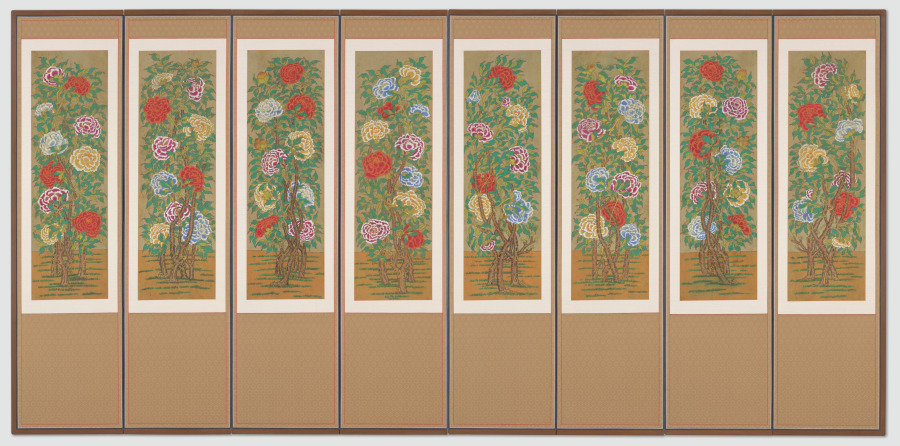
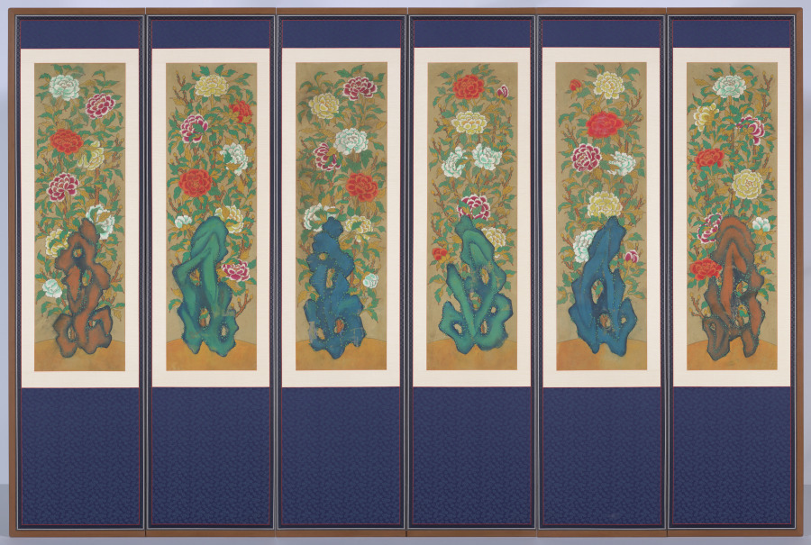
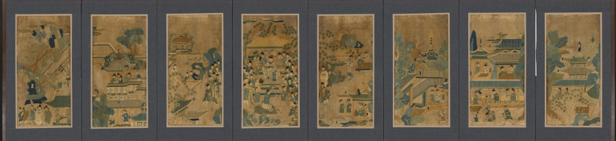
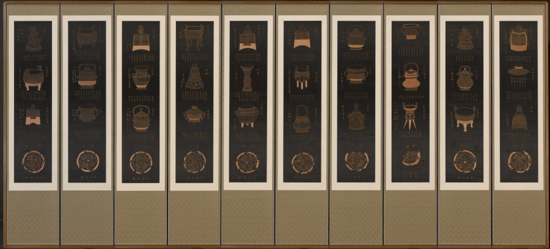
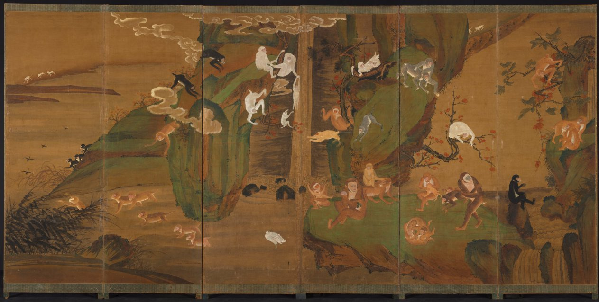

A peony fills a folding screen. Does that mean the screen stood at a wedding? The flower is a useful clue, but it is not a receipt for an occasion.

A good reading keeps the motif, the individual object and the occasion in separate boxes. A collection record can explain an association without documenting every use of the screen.

<strong>Editorial method:</strong> AI assisted the research and drafting; the evidence-gated editorial process checked the cited sources, and manual review remains pending.

The header is AI-generated editorial art, not a photograph or evidence of a historical screen. The five photographs below show distinct works in The Cleveland Museum of Art’s collection; the captions link to their records and image license.

<h3>Start with the flower, then check the object</h3>

Cleveland identifies <em>Peonies</em> (2022.59) as an early-1900s Korean eight-panel screen in ink and color on silk, and associates peonies with prosperity and wealth. The museum gives either the Joseon or Japanese colonial period for this work and suggests wedding use as a possibility, not a documented event.

<figure class="post-photo source-image"><figcaption>Peonies, early 1900s. The Cleveland Museum of Art, Gift of The Honorable Joseph P. Carroll, KM, and Roberta Carroll, M.D., 2022.59. CC0. <a href="https://clevelandart.org/art/2022.59">Source record: https://clevelandart.org/art/2022.59</a>; <a href="https://www.clevelandart.org/open-access">license: https://www.clevelandart.org/open-access</a>.</figcaption></figure>

A second work, <em>Peonies and Rocks</em> (2022.60), is a separate early-1900s Korean screen with six panels, also painted on silk. The museum places it in either the Joseon or Japanese colonial period. Its flowers invite comparison, but the shared motif does not establish a shared occasion.

<figure class="post-photo source-image"><figcaption>Peonies and Rocks, early 1900s. The Cleveland Museum of Art, Gift of The Honorable Joseph P. Carroll, KM, and Roberta Carroll, M.D., 2022.60. CC0. <a href="https://clevelandart.org/art/2022.60">Source record: https://clevelandart.org/art/2022.60</a>; <a href="https://www.clevelandart.org/open-access">license: https://www.clevelandart.org/open-access</a>.</figcaption></figure>
<!--post-ad-break-->
<h3>A scene can carry a wish, too</h3>

In Cleveland’s Korean embroidered screen <em>General Guo Ziyi’s Birthday Banquet</em>, the subject is a Chinese general. The museum interprets the general surrounded by his many family members as an image of success and happiness. Its record lists later owners, but does not establish the original household or occasion for which the screen was used.

<figure class="post-photo source-image"><figcaption>General Guo Ziyi’s Birthday Banquet, early or mid-1800s. The Cleveland Museum of Art, gift of the honorable Joseph P. Carroll, KM, and Roberta Carroll, M.D., in recognition of the contribution of Marjorie Williams to the development of The Cleveland Museum of Art, 2020.87. CC0. <a href="https://clevelandart.org/art/2020.87">Source record: https://clevelandart.org/art/2020.87</a>; <a href="https://www.clevelandart.org/open-access">license: https://www.clevelandart.org/open-access</a>.</figcaption></figure>
<h3>Look for the words beside the objects</h3>

Cleveland says the inscriptions accompanying the bronze vessels in its late-1800s Korean screen <em>Ancient Chinese Bronzes</em> express wishes for good fortune and many children. The museum suggests that those wishes might relate to performing ancestral rituals; it does not establish that this individual screen was actually used in one.

<figure class="post-photo source-image"><figcaption>Ancient Chinese Bronzes, late 1800s. The Cleveland Museum of Art, Gift of the Honorable Joseph P. Carroll, KM, and Roberta Carroll, M.D., in recognition of the contribution of Marjorie Williams to the development of The Cleveland Museum of Art, 2020.86. CC0. <a href="https://clevelandart.org/art/2020.86">Source record: https://clevelandart.org/art/2020.86</a>; <a href="https://www.clevelandart.org/open-access">license: https://www.clevelandart.org/open-access</a>.</figcaption></figure>
<h3>Read combinations rather than a universal code</h3>

For <em>Gibbons in a Landscape</em>, Cleveland interprets gibbons paired with red autumn foliage as professional success and a peach as prosperity and longevity. That is the museum’s reading of this work and its particular combinations, not a key that automatically explains every animal image.

<figure class="post-photo source-image"><figcaption>Gibbons in a Landscape, early 1900s. The Cleveland Museum of Art, Leonard C. Hanna Jr. Fund, 1996.256. CC0. <a href="https://clevelandart.org/art/1996.256">Source record: https://clevelandart.org/art/1996.256</a>; <a href="https://www.clevelandart.org/open-access">license: https://www.clevelandart.org/open-access</a>.</figcaption></figure>

The caption follows the museum’s early-1900s label. Its record also lists the Joseon dynasty, while its machine-readable date range ends in 1940, beyond that dynasty’s end in 1910. These are differing metadata fields, not proof that the screen was made in 1940; check the record rather than treating one field as a definitive answer.

<h3>A small label-reading checklist</h3>
<ol><li>Identify the exact object and the motifs shown together, not just the most familiar flower or animal.</li><li>Ask which institution supplies the interpretation and whether it describes a broad association or this specific work.</li><li>Separate a possible use from a documented one, and keep uncertain or conflicting date fields visible.</li></ol>

For another way to read a collection label without turning a useful term into a rigid box, see <a href="/journal/Korean-Celadon-Labels-Describe-Techniques-Not-Exclusive-Boxes/">the guide to Korean celadon technique labels</a>. The best next question is often a modest one: what does this object’s own record actually say?

