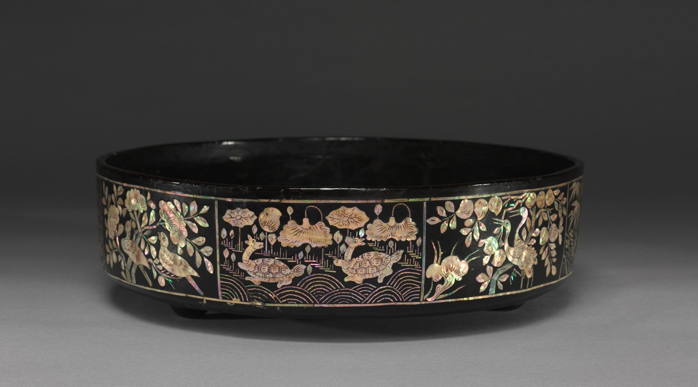
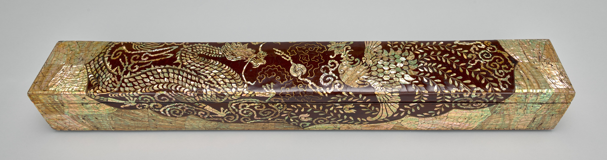
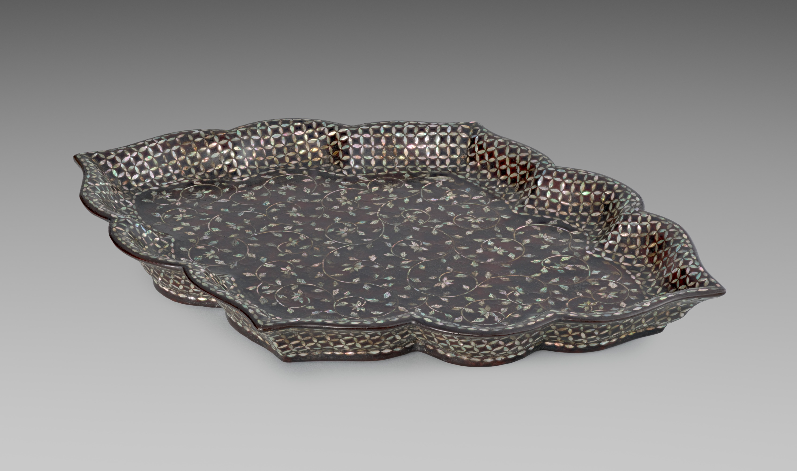
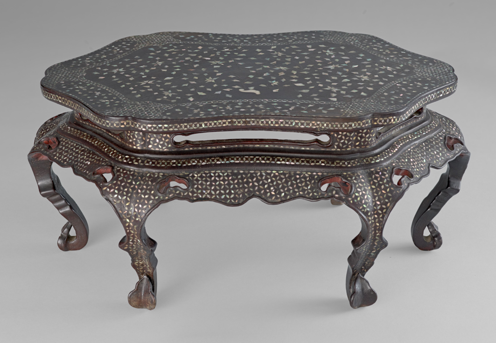

The sewing tray in the photograph below has plenty to distract the eye. Its mother-of-pearl decoration is not, however, the most surprising part of its construction. Beneath the lacquer is leather, according to the Cleveland Museum of Art. Not the wood a reader might have supplied almost without thinking.

That small correction opens a useful way to compare Korean lacquer objects. Ask three separate questions: what supports the surface, what has been applied or inserted, and what job the object was made to do. These four museum records give different answers, including an unanswered question and a carefully qualified interpretation. The comparison here is a reading tool, not a classification system for all Korean lacquerware.

<h3>1. What is underneath the lacquer?</h3>

The museum dates its Tray for Sewing Tools with Mother-of-Pearl Inlay, accession 1987.42, to the 1800s and identifies it as Korean, Joseon dynasty. Its medium field says lacquer with mother-of-pearl inlay. The leather appears elsewhere, in the page's construction note.

For this tray, the museum describes many thin layers of lacquer applied to a leather core, then a design cut into the dry lacquer before the mother-of-pearl was inserted. That sequence explains this particular object. It is not a recipe to carry across to every tray with a similar surface.

<figure class="post-photo source-image">
<figcaption>Unnamed Korean maker, Tray for Sewing Tools with Mother-of-Pearl Inlay, 1800s. The Cleveland Museum of Art, Norman O. Stone and Ella A. Stone Memorial Fund, 1987.42. CC0. Source: <a href="https://www.clevelandart.org/art/1987.42">https://www.clevelandart.org/art/1987.42</a> · License: <a href="https://creativecommons.org/publicdomain/zero/1.0/">https://creativecommons.org/publicdomain/zero/1.0/</a> · The Cleveland Museum of Art; unnamed Korean maker (no individual maker or photographer credited)</figcaption></figure>

Set that account beside the Scroll Box with Dragon and Phoenix Design, 1990.15, also dated to the 1800s and attributed to Korea, Joseon dynasty. Here the museum explicitly lists lacquered wood inlaid with mother-of-pearl and twisted brass and copper wire. Leather under one decorated surface; wood under the other. The shared shell inlay does not establish a shared core.

<figure class="post-photo source-image">
<figcaption>Unnamed Korean maker, Scroll Box with Dragon and Phoenix Design, 1800s. The Cleveland Museum of Art, Severance and Greta Millikin Collection, 1990.15. CC0. Source: <a href="https://www.clevelandart.org/art/1990.15">https://www.clevelandart.org/art/1990.15</a> · License: <a href="https://creativecommons.org/publicdomain/zero/1.0/">https://creativecommons.org/publicdomain/zero/1.0/</a> · The Cleveland Museum of Art; unnamed Korean maker (no individual maker or photographer credited)</figcaption></figure>

For a useful comparison note, keep the support in its own space. Write leather for the sewing tray and wood for the box, because their records establish those materials. Do not let the decoration answer the support question on its own.

<h3>2. What has been inserted or applied?</h3>

The Foliate-Shaped Tray with Mother-of-Pearl Inlay, 2026.3, makes the distinction harder to overlook. The museum dates this Korean Joseon tray to the late 1400s–early 1500s. Its record names inlaid abalone shell on a black lacquer ground, with red lacquer on the interior, and describes thin, precisely cut shell.

Those are useful material details, but the displayed record does not identify the tray's core. It also does not establish a specific original serving use. Leave those spaces open. An unspecified support is not a wooden support by default, nor evidence that the object somehow had no support at all.

<figure class="post-photo source-image">
<figcaption>Unnamed Korean maker, Foliate-Shaped Tray with Mother-of-Pearl Inlay, late 1400s–early 1500s. The Cleveland Museum of Art, Sundry Art - Miscellaneous Fund, 2026.3. CC0. Source: <a href="https://www.clevelandart.org/art/2026.3">https://www.clevelandart.org/art/2026.3</a> · License: <a href="https://creativecommons.org/publicdomain/zero/1.0/">https://creativecommons.org/publicdomain/zero/1.0/</a> · The Cleveland Museum of Art; unnamed Korean maker (no individual maker or photographer credited)</figcaption></figure>

The box adds another reason to read beyond the words mother-of-pearl: its material list includes metal wire as well as shell. The Hexafoil-Shaped Table with Mother-of-Pearl Inlay adds a smaller cataloguing snag. Its medium field names abalone shell and black and red lacquer; its description additionally identifies twisted brass-wire inlay, alongside mother-of-pearl, forming chrysanthemum scrolls and floral lattices. Reading only the medium field would miss the wire.

Keep the objects' material lists separate. Copper is named for the box, not for the table. Abalone is named for the foliate tray and table, but the sewing tray's construction note does not identify a shell species. A more detailed record can help explain its own object without filling the gaps in a neighbouring one.

<!--post-ad-break-->

<h3>3. What does the record establish about its job?</h3>

The sewing tray's title supplies a functional identification: sewing tools. For the long rectangular box, the museum says it was designed to keep a scroll or an important document. Its listed overall dimensions are 11.5 × 11.6 × 87 cm. That is a document-storage account, not evidence of a particular document that survived inside it.

The low table needs a different kind of answer. The museum dates the Hexafoil-Shaped Table with Mother-of-Pearl Inlay, 2026.4, to the late 1400s–early 1500s and attributes it to Korea, Joseon dynasty. Its description proposes that it was likely used in Buddhist offering ceremonies and would have supported ritual objects such as sutra rolls or miniature Buddhist statuary. This is the museum's interpretation, not a documented occasion of use.

<figure class="post-photo source-image">
<figcaption>Unnamed Korean maker, Hexafoil-Shaped Table with Mother-of-Pearl Inlay, late 1400s–early 1500s. The Cleveland Museum of Art, Sundry Art - Miscellaneous Fund, 2026.4. CC0. Source: <a href="https://www.clevelandart.org/art/2026.4">https://www.clevelandart.org/art/2026.4</a> · License: <a href="https://creativecommons.org/publicdomain/zero/1.0/">https://creativecommons.org/publicdomain/zero/1.0/</a> · The Cleveland Museum of Art; unnamed Korean maker (no individual maker or photographer credited)</figcaption></figure>

The word likely matters. Replacing it with a definite ritual use would overstate the record; replacing it with an ordinary dining use would supply a different story altogether. Neither move helps the reader understand this table.

Try the three questions side by side rather than arranging the objects into a prettier-to-plainer ranking. The sewing tray supplies a leather core and a sewing identification. The box supplies wood, shell and two named metals, with document storage as its stated purpose. The foliate tray supplies specific shell-and-lacquer details but leaves the core and particular use unspecified. The table supplies shell, lacquer and brass wire, with a likely ritual role. Similar decoration is the beginning of this comparison, not its conclusion.

<h3>Take the questions, not the assumptions</h3>

On the next collection page, look for an explicit support material, then read both the medium field and the description for the surface materials. Finally, copy the strength of the function claim: an identification, an interpretation with likely attached, or no specific job established. Leaving a blank is more useful than quietly borrowing an answer from another object.

For a comparison on a different material, the guide to <a href="/journal/Korean-Celadon-Labels-Describe-Techniques-Not-Exclusive-Boxes/">Korean celadon technique labels</a> explores what ceramic labels reveal and leave out. Ceramic inlay is not this shell-into-lacquer material process; the useful connection is the habit of separating a technique name from everything else an object record can tell.

The four collection records were checked on 3 November 2026. This guide stays within their material descriptions and qualified functional accounts; it does not reconstruct an unknown core or original owner. The source photographs carry their individual CC0 credits above. The cover is an invented AI illustration, not a museum specimen or a photograph of one of these four objects.

<strong>Editorial method:</strong> AI assisted the research and drafting, with independent AI source and image-rights reviews. The owner authorized publication; no human editing or human fact-check is claimed.

