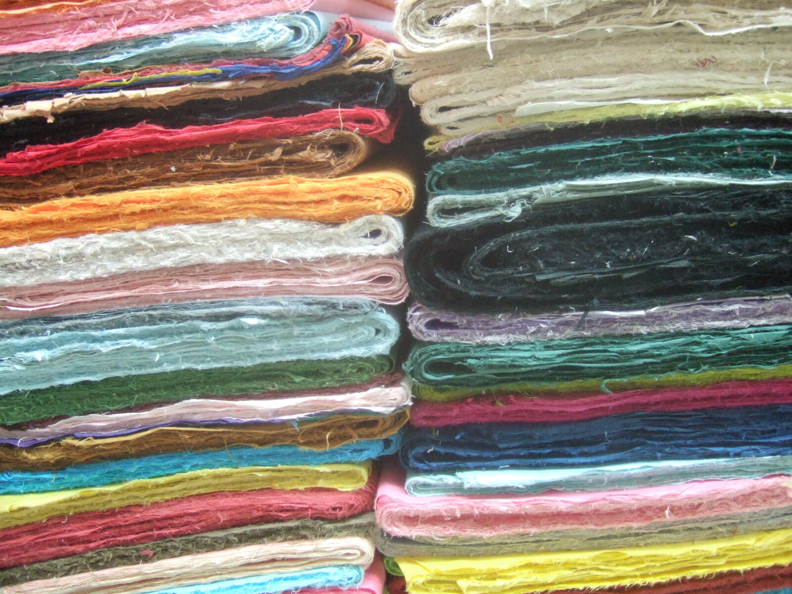
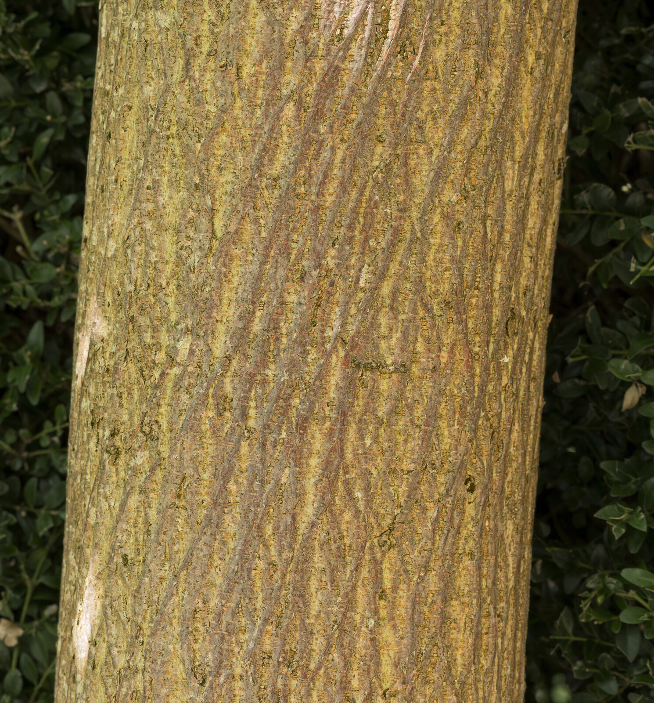
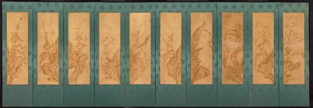
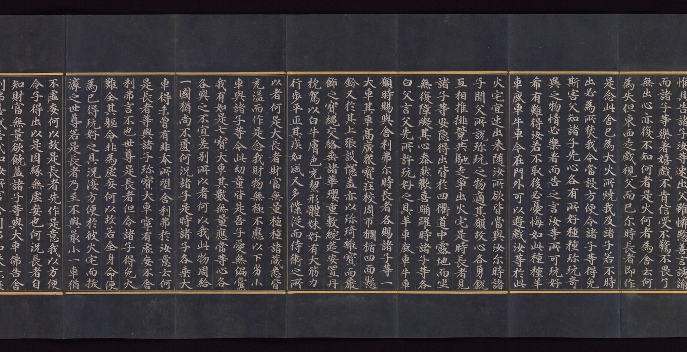

A stack of textured sheets can invite a wonderfully simple question: is this 한지 (hanji), Korean paper? The useful answer starts with another question: what can the evidence actually show?

A photograph can show a surface. A collection label can name an object and its recorded material. A scientific study can identify material in what was examined, within the study's limits. Keeping those kinds of evidence apart makes a guide to paper more useful than a confident guess from a pretty picture.

<strong>Editorial method:</strong> AI assisted the research and drafting under an evidence-gated editorial process. No first-hand visit or per-post human editorial review is claimed.

The cover is an AI-generated editorial still life, not a photograph of an historical object or evidence of a papermaking process.

<h3>Start with what the picture shows</h3>

The Commons description identifies the photograph below as hand-pressed papers in Insadong, Seoul. Appearance alone does not establish the fibre or exact technique of every sheet. Enjoy the folds and variation, but leave room for a label or a maker's explanation to answer a different question.

<figure class="post-photo source-image">

<figcaption>Hand-pressed papers photographed in Insadong; appearance does not establish each sheet’s fibre. jared; CC BY 2.0; resized, re-encoded and metadata stripped. Source: <a href="https://commons.wikimedia.org/wiki/File:Seoul-Insadong-Papers.jpg">https://commons.wikimedia.org/wiki/File:Seoul-Insadong-Papers.jpg</a>. License: <a href="https://creativecommons.org/licenses/by/2.0/">https://creativecommons.org/licenses/by/2.0/</a>.</figcaption>
</figure>

The next photograph is paper mulberry trunk and bark in France. It shows natural bark, not processed fibre or a Korean workshop. It is a useful visual starting point for the plant named in the study below, but it cannot show how any particular sheet was made.

<figure class="post-photo source-image">

<figcaption>Paper mulberry trunk and bark photographed in France; not processed fibre. Didier Descouens; CC BY-SA 4.0; resized, re-encoded and metadata stripped; adaptation under the same license. Source: <a href="https://commons.wikimedia.org/wiki/File:Broussonetia_papyrifera_MHNT_Texture_of_the_trunk.jpg">https://commons.wikimedia.org/wiki/File:Broussonetia_papyrifera_MHNT_Texture_of_the_trunk.jpg</a>. License: <a href="https://creativecommons.org/licenses/by-sa/4.0/">https://creativecommons.org/licenses/by-sa/4.0/</a>.</figcaption>
</figure>

A practical habit is to ask for the material and the basis for the description separately. Is a seller or museum naming a fibre, a technique, a place, or simply the appearance? If the answer is not supplied, it is fine to keep the question open. A photo does not need to do the work of a microscope.

<h3>Paper can be an object as well as a page</h3>

Jeonju National Museum describes hanji crafts made by cutting or twisting paper into small things needed for daily life, within its gallery of arts and crafts. That gallery context is a helpful reminder of uses beyond writing; it does not establish what every household used or what a modern product contains.

For a different kind of paper object, the Cleveland Museum of Art identifies <a href="https://www.clevelandart.org/art/1991.80">Birds and Flowers</a> as a Korean screen from the late 1800s. Its record describes designs and inscriptions burnt into paper, a technique called pyrography. The museum does not specify hanji or the fibres, so the screen should not be presented as verified hanji.

<figure class="post-photo source-image">

<figcaption>Birds and Flowers, a Korean screen with designs burnt into paper; the museum does not specify hanji. Cleveland Museum of Art, Birds and Flowers, 1991.80; Seventy-fifth anniversary gift of Alan Carter Covell and Kyu J. Pak-Covell; CC0; re-encoded and metadata stripped. Source: <a href="https://www.clevelandart.org/art/1991.80">https://www.clevelandart.org/art/1991.80</a>. License: <a href="https://creativecommons.org/publicdomain/zero/1.0/">https://creativecommons.org/publicdomain/zero/1.0/</a>.</figcaption>
</figure>

That distinction leaves plenty to look at. A material description can tell a reader about the recorded medium and technique without answering every question about the paper underneath. When a label is silent on fibre, silence is a limit of that record, not proof of a particular fibre.

<!--post-ad-break-->
<h3>A manuscript is not a study specimen</h3>

The Metropolitan Museum of Art identifies its <a href="https://www.metmuseum.org/art/collection/search/36451">Lotus Sutra manuscript</a>, object 1994.207, as a Korean work from around 1340, made with gold and silver on indigo-dyed mulberry paper. This Goryeo manuscript is a separate object from the Oegyujanggak Uigwe examined in the study below; the photograph is not a picture of a study sample.

<figure class="post-photo source-image">

<figcaption>Goryeo Lotus Sutra manuscript on indigo-dyed mulberry paper; a separate object from the Uigwe study. The Metropolitan Museum of Art, Illustrated manuscript of the Lotus Sutra, Volume 2, 1994.207; Purchase, Lila Acheson Wallace Gift, 1994; image DP270191, CC0; resized, re-encoded and metadata stripped. Source: <a href="https://commons.wikimedia.org/wiki/File:%EB%B2%95%ED%99%94%EA%B2%BD%EB%B3%80%EC%83%81%EB%8F%84_%EA%B3%A0%EB%A0%A4-%E5%A6%99%E6%B3%95%E8%93%AE%E8%8F%AF%E7%B6%93%E5%8D%B7%E7%AC%AC%E4%BA%8C%E8%AE%8A%E7%9B%B8%E5%9C%96_%E9%AB%98%E9%BA%97-Illustrated_Manuscript_of_the_Lotus_Sutra_MET_DP270191.jpg">https://commons.wikimedia.org/wiki/File:%EB%B2%95%ED%99%94%EA%B2%BD%EB%B3%80%EC%83%81%EB%8F%84_%EA%B3%A0%EB%A0%A4-%E5%A6%99%E6%B3%95%E8%93%AE%E8%8F%AF%E7%B6%93%E5%8D%B7%E7%AC%AC%E4%BA%8C%E8%AE%8A%E7%9B%B8%E5%9C%96_%E9%AB%98%E9%BA%97-Illustrated_Manuscript_of_the_Lotus_Sutra_MET_DP270191.jpg</a>. License: <a href="https://creativecommons.org/publicdomain/zero/1.0/">https://creativecommons.org/publicdomain/zero/1.0/</a>.</figcaption>
</figure>

The object record gives the manuscript a specific identity, date and medium. It does not make the manuscript interchangeable with another book simply because both involve paper. Keeping the object number or source link nearby makes that distinction easier to check later.

<h3>Read the study's sample, too</h3>

A 2014 <a href="https://www.museum.go.kr/uigwe/data/downloads/Bookbinding_of_the_Oegyujanggak_Uigwe.pdf">National Museum of Korea study</a> concerns Oegyujanggak Uigwe, records of Joseon state rites. It examined 40 copies: 35 king's copies and five general copies. Those numbers count copies, not fibre specimens.

The study reports that C-stain analysis identified paper-mulberry fibres in paper from both king's and general copies. The bound paper limited examination; this result should not be taken to mean every sheet was sampled. The authors also caution that the imbalance between 35 king's copies and five general copies made direct comparison difficult.

This is a valuable, bounded finding, not a test of every historical Korean book or modern paper label. It can support a statement about the examined copies; it cannot identify the fibre of a sheet in an unrelated photograph. When reading a scientific claim, look for the objects studied, the method and the authors' own caveats before carrying the result elsewhere.

<h3>A small evidence ladder to take along</h3>

For a photograph, ask what is visible and what its description says. For an object record, note the institution, object number, date and named medium. For a study, check what was sampled and whether a comparison has enough context. These steps are questions for the evidence, not a promise that every source will answer them.

Sources for this guide were recorded on 13 November 2026; the museum study itself was published in 2014. Collection descriptions and image rights can change, so return to the linked records when making a new claim or reuse decision. The original image downloads were recorded by a completion bound rather than individual download times.

To keep exploring how a particular decorated object gains meaning from its context, read <a href="/journal/How-To-Read-Wishes-On-Korean-Folding-Screens/">How to Read Wishes on Korean Folding Screens</a> or see <a href="/journal/What-Lies-Beneath-Korean-Mother-Of-Pearl-Lacquer/">What Lies Beneath Korean Mother-Of-Pearl Lacquer</a> for another look at material and technique distinctions in traditional craft objects. A careful label is a lovely place to begin; a good question can stay open when the label runs out.

