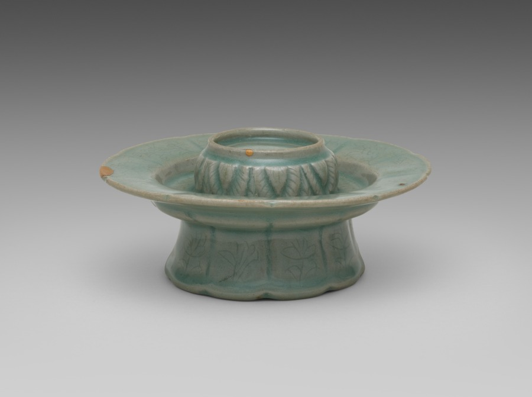
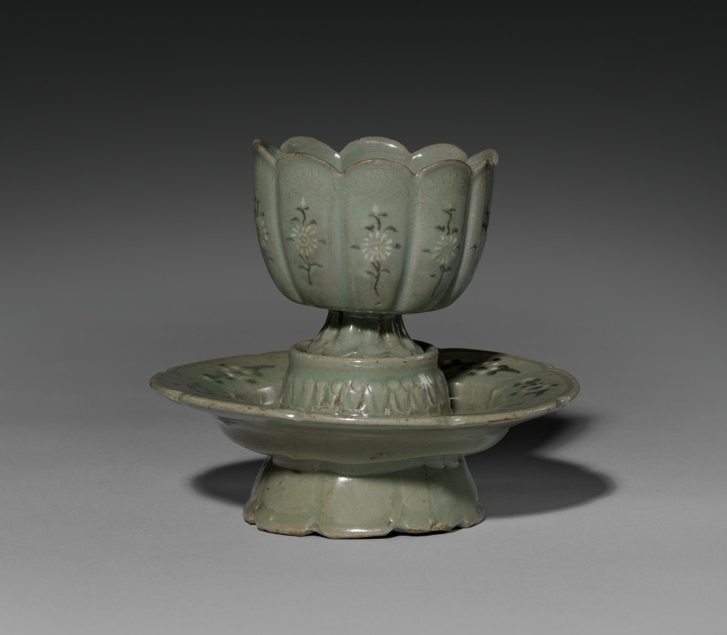
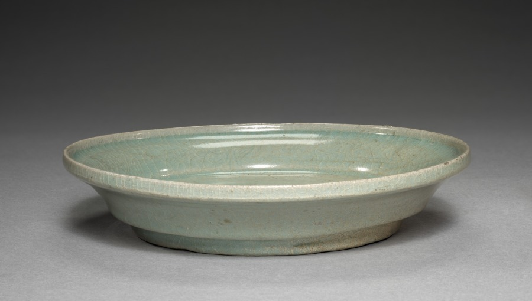
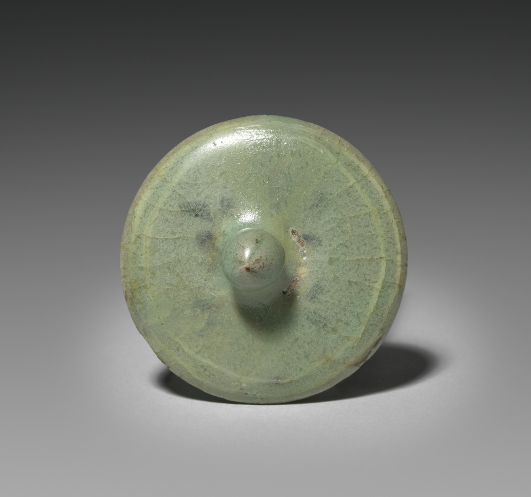

Standing before a vitrine of Korean celadon in a museum gallery, visitors are often captivated by the luminous blue-green jade hue known as 비색 (bisaek, secret jade color). Yet if one looks closely at the smaller vessels—especially those designed for tea ceremonies during the height of the Goryeo dynasty (918–1392)—a remarkable interplay of sculptural architecture, botanical geometry, and dual-slip inlay emerges.

Drinking tea in aristocratic and monastic Goryeo was not a hurried daily routine; it was a refined ritual of state hospitality and spiritual meditation. Understanding how potters in Gangjin and Buan engineered two-piece cup stands, carved delicate lotus petals, and perfected the world's first inlaid slip techniques transforms museum viewing into an illuminating study of medieval craft.

<strong>Editorial method:</strong> AI assisted the research and drafting under an evidence-gated editorial process. No first-hand visit or per-post human editorial review is claimed.

The cover image is an AI-generated editorial still life symbolizing the restrained elegance of Goryeo celadon tea ware, not a photograph of a specific historical collection piece.

<h3>The two-piece architecture of the Jantak cup stand</h3>

Modern tea drinkers usually expect a flat saucer under a cup. In Goryeo ceramic culture, however, the cup was paired with a specialized architectural stand called a 잔탁 (jantak, cup stand and saucer). The vessel features a raised central pedestal hollowed to cradle the foot of a tall, fluted cup.

<figure class="post-photo source-image">
  
  <figcaption>Floral-shaped celadon cup stand, 1100s–1200s; carved lobed flange cradles a central raised cup pedestal. Cleveland Museum of Art, Floral-shaped Cup Stand, 1918.430; The Worcester R. Warner Collection; CC0; metadata stripped. Source: <a href="https://clevelandart.org/art/1918.430">https://clevelandart.org/art/1918.430</a>. License: <a href="https://creativecommons.org/publicdomain/zero/1.0/">https://creativecommons.org/publicdomain/zero/1.0/</a>.</figcaption>
</figure>

Cleveland Museum of Art object 1918.430 is a 12th-to-13th-century Goryeo stoneware cup stand with celadon glaze. The wide horizontal rim is carved into delicate foliate lobes resembling an open blossom. This broad flange protected the drinker's hands from the steaming heat of the boiling water, while the central collar kept the slender cup stable during formal palace banquets and Buddhist rituals.

<!--post-ad-break-->

<h3>Reading the inlay: the Sang-gam technique</h3>

While neighboring Song dynasty kilns produced monochrome glazes, Goryeo potters pioneered a revolutionary decorative technique unique to Korea: 상감 (sanggam, inlaid celadon). Rather than painting minerals onto the surface, the potter carved grooves into the leather-hard clay, inlaid white kaolin and red iron-rich slips into the carvings, scraped the surface flush, and fired the piece under a transparent green-gray glaze.

<figure class="post-photo source-image">
  
  <figcaption>Floral-shaped cup and saucer with inlaid chrysanthemum design, 1100s–1200s; white and black sanggam slips beneath a luminous celadon glaze. Cleveland Museum of Art, Floral-shaped Cup and Saucer with Inlaid Chrysanthemum Design, 1928.171; Gift of Dr. and Mrs. Sherman E. Lee; CC0; metadata stripped. Source: <a href="https://clevelandart.org/art/1928.171">https://clevelandart.org/art/1928.171</a>. License: <a href="https://creativecommons.org/publicdomain/zero/1.0/">https://creativecommons.org/publicdomain/zero/1.0/</a>.</figcaption>
</figure>

Cleveland Museum of Art object 1928.171 is an 1100s–1200s floral-shaped cup and matching saucer inlaid with chrysanthemum medallions. Under high kiln temperatures, the white slip fires to a crisp snow-white, while the iron-rich red slip turns carbon-black under a reduction flame. The resulting contrast gives the delicate flower roundels extraordinary clarity beneath the glassy translucent glaze.

<h3>Carving light and shadow: incised lotus and peony petals</h3>

Before inlaid celadon became dominant in the mid-1100s, Goryeo potters mastered 음각 (eumgak, incised carving) and 양각 (yanggak, relief carving). By angling the bamboo knife as it cut into the wet clay, the craftsman created varying groove depths. During firing, the liquid celadon glaze pooled deeper in the valleys, creating natural shading and translucent depth.

<figure class="post-photo source-image">
  
  <figcaption>Bowl and saucer with incised lotus and peony design, 1100s; variable glaze pooling creates natural shading along petal contours. Cleveland Museum of Art, Bowl and Saucer with Incised Lotus and Peony Design, 1918.455; The Worcester R. Warner Collection; CC0; metadata stripped. Source: <a href="https://clevelandart.org/art/1918.455">https://clevelandart.org/art/1918.455</a>. License: <a href="https://creativecommons.org/publicdomain/zero/1.0/">https://creativecommons.org/publicdomain/zero/1.0/</a>.</figcaption>
</figure>

Cleveland Museum of Art object 1918.455 is an 1100s celadon bowl and saucer decorated with incised lotus and peony motifs. The lotus symbolized purity and Buddhist awakening, blossoming untainted from muddy pond waters, while the peony represented noble honor and prosperity. Notice how the glaze thickens into deep emerald pools within the carved outlines, emphasizing the botanical curvature without a single drop of painted pigment.

<h3>Sculptural functionalism: pitcher covers and animal finials</h3>

Tea preparation required pouring hot water from tall ceramic ewers. Goryeo potters treated the lids and spouts of these vessels not merely as utilitarian closures, but as miniature sculptural artworks depicting bamboo shoots, gourds, ducks, and lotus buds.

<figure class="post-photo source-image">
  
  <figcaption>Cover for a pitcher, 1100s; sculptural handle knob designed for secure handling during tea pouring. Cleveland Museum of Art, Cover for a Pitcher, 1917.1090; Gift of Charles W. Harkness; CC0; metadata stripped. Source: <a href="https://clevelandart.org/art/1917.1090">https://clevelandart.org/art/1917.1090</a>. License: <a href="https://creativecommons.org/publicdomain/zero/1.0/">https://creativecommons.org/publicdomain/zero/1.0/</a>.</figcaption>
</figure>

Cleveland Museum of Art object 1917.1090 is an 1100s celadon pitcher lid featuring an integrated knob handle and pierced loop for securing a silk cord. The potter sculpted the handle to fit comfortably between the fingertips, ensuring the lid would not slip when tilting the ewer. Such ergonomic details reflect a society where tea ceremonies were conducted with rigorous precision and tactile mindfulness.

<h3>A quick field guide to celadon gallery labels</h3>

When you stand before a display case of Goryeo ceramics, look for these three diagnostic cues:

1. **Examine the stand:** Check whether a cup rests on a raised pedestal collar. If the saucer has a central cylindrical tower, it is a formal jantak designed to hold boiling ceremonial tea.

2. **Check the flower colors:** If a chrysanthemum blossom features white petals surrounded by a fine black ring, you are observing sanggam inlay—two distinct mineral slips carved into the clay before firing.

3. **Trace the glaze pooling:** If a lotus petal has no color difference but appears in deep emerald relief, look closely at the depth of the carved groove where the liquid glaze gathered during reduction cooling.

To see how Korean ceramics transitioned from the aristocratic celadon of Goryeo to the understated white porcelain of the Joseon dynasty, explore our visual guide on <a href="/journal/How-To-Read-Wishes-And-Shapes-On-Joseon-White-Porcelain/">How to Read Wishes and Shapes on Joseon White Porcelain</a>. You can also trace how ceramic naming conventions evolved across museum records in <a href="/journal/Korean-Celadon-Labels-Describe-Techniques-Not-Exclusive-Boxes/">Korean Celadon Labels Describe Techniques, Not Exclusive Boxes</a>.

