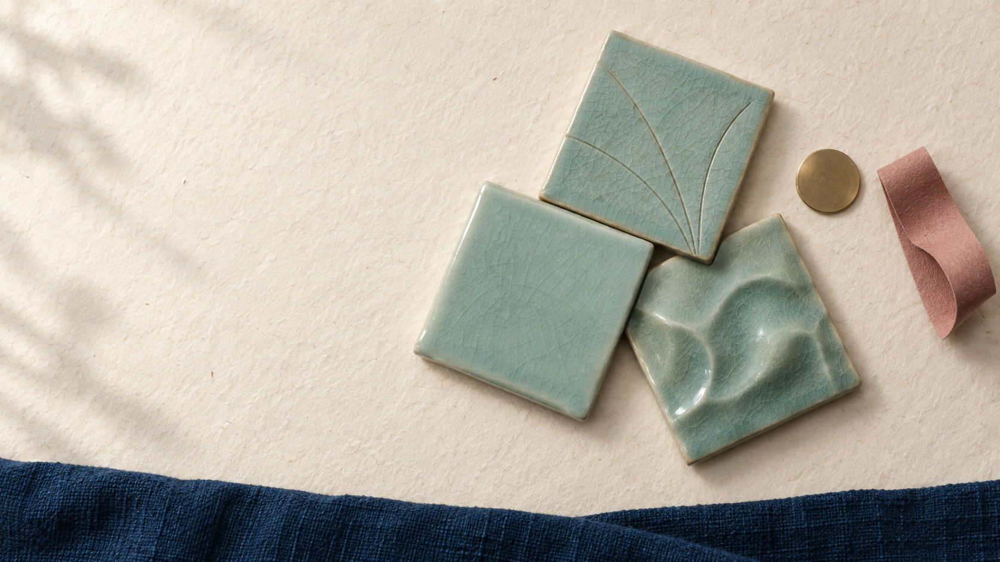
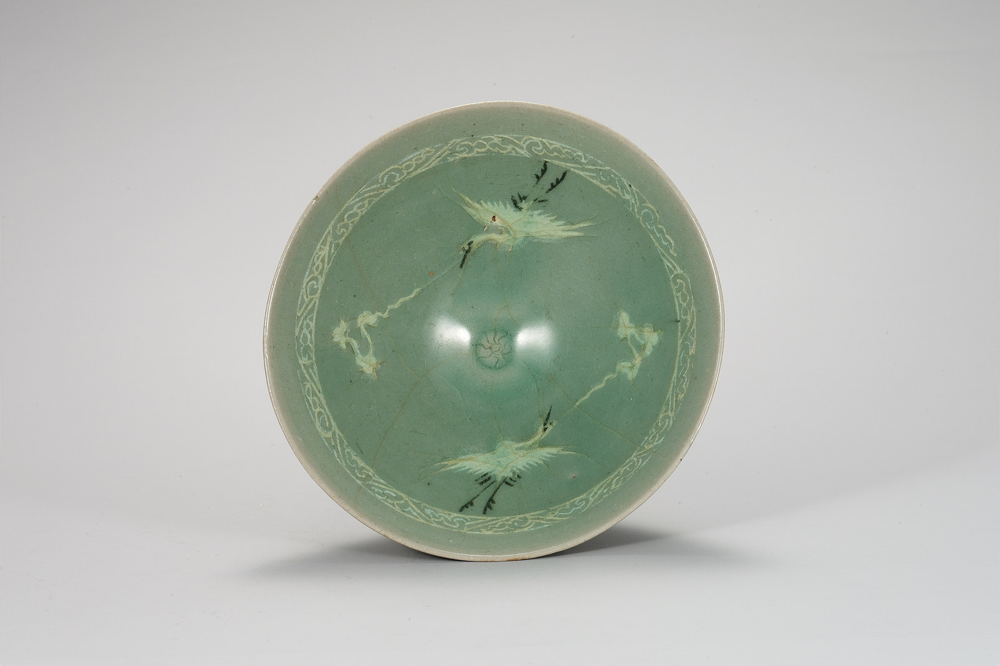
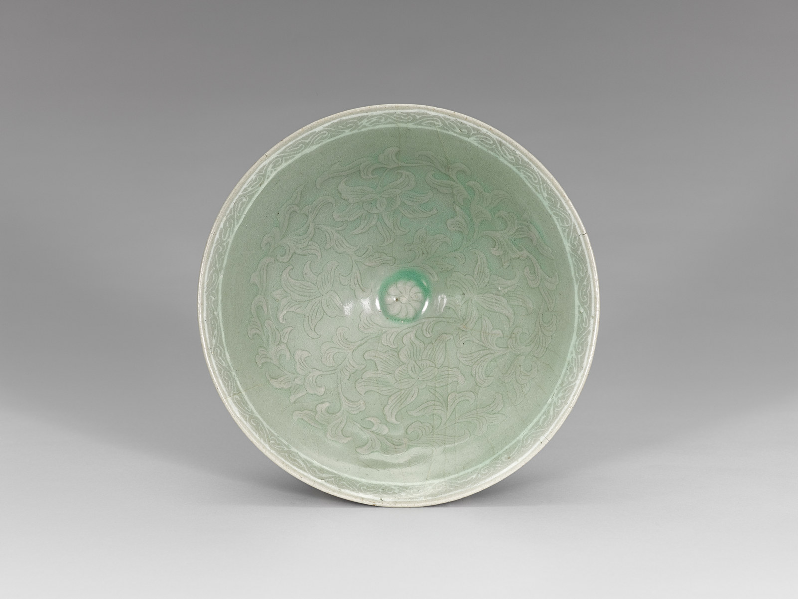
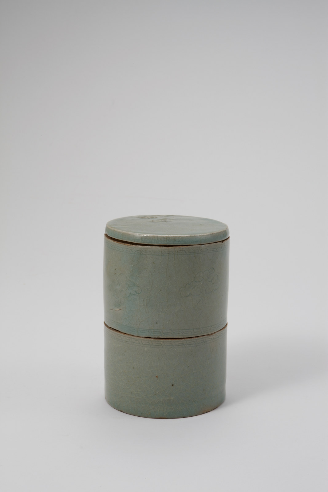
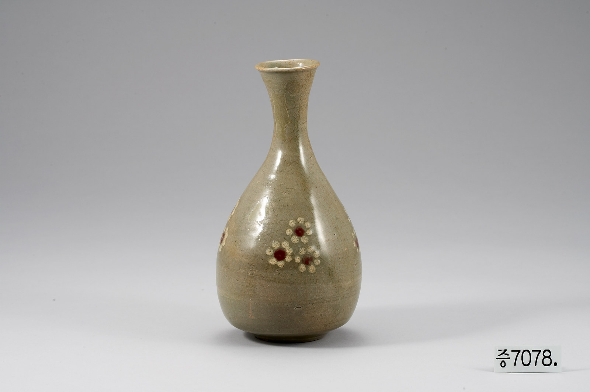

When looking through the glass at a Goryeo celadon exhibition, it is tempting to see only a shimmering sea of jade-green glaze. But the museum label in the corner holds a code: words like *Sanggam*, *Yanggak*, *Eumgak*, and *Donghwa* tell you exactly how the craftsman shaped the clay before it ever met the fire.

Goryeo celadon (고려청자) is celebrated worldwide for its translucent jade colour. Yet what distinguished Korean master potters in the 12th and 13th centuries was not merely their glaze chemistry, but their mastery of surface decoration beneath that glaze.

Learning to decode which technique was used transforms a passive museum visit into an active discovery of historical craftsmanship.

<figure class="post-photo source-image">
  
  <figcaption>Editorial concept still life of Goryeo celadon forms; illustrative context for museum collection studies.</figcaption>
</figure>

### Inlaid Celadon (상감, Sanggam)

Inlay is Goryeo’s most celebrated contribution to ceramic history. The artisan carved precise channels into the semi-dry leather-hard clay, filled those depressions with contrasting white or red-brown clay slip, and scraped the surface completely flush before glazing.

<figure class="post-photo source-image">
  
  <figcaption>Celadon Bowl with Inlaid Cloud and Crane Design (청자 상감 운학문 대접), Goryeo dynasty. National Museum of Korea, Deoksu-3147. KOGL Type 1.</figcaption>
</figure>

**Visual Clue:** Look closely at the cranes soaring through white clouds. The white feathers and dark black beaks are perfectly flush with the celadon body, sealed underneath a clear glaze like a delicate mosaic.

### Carved and Incised Celadon (음각·양각, Eumgak and Yanggak)

Before inlay became widespread, potters used fine metal tools to carve directly into the vessel wall. In incised celadon (음각), shallow grooves catch the fluid glaze, creating delicate darker outlines. In carved relief (양각), the background is carved away so the floral petals physically protrude.

<figure class="post-photo source-image">
  
  <figcaption>Celadon Bowl with Carved Relief Peony Scroll Design (청자 양각 모란당초문 대접), Goryeo dynasty. National Museum of Korea, Deoksu-2336. KOGL Type 1.</figcaption>
</figure>

Because celadon glaze is translucent, it pools deeper in carved recesses (appearing dark jade) while thinning over raised petal ridges (glowing pale green). The contrast is entirely optical.

<figure class="post-photo source-image">
  
  <figcaption>Celadon Lidded Box with Incised Lotus Design (청자 음각 연화문 합), Goryeo dynasty. National Museum of Korea, Deoksu-6319. KOGL Type 1.</figcaption>
</figure>

### Underglaze Copper (동화, Donghwa)

Copper oxide is among the most temperamental ceramic pigments ever formulated. When fired in an oxygen-deprived reduction kiln, it turns a striking purplish-crimson; if oxygen enters, it turns dull green. Goryeo potters mastered underglaze copper centuries before it appeared reliably elsewhere.

<figure class="post-photo source-image">
  
  <figcaption>Celadon Bottle with Underglaze Copper and Inlaid White Dots (청자 동화 백점문 병), Goryeo dynasty. National Museum of Korea, Jeung-7078. KOGL Type 1.</figcaption>
</figure>

**Visual Clue:** Look for distinct reddish-purple or strawberry-colored dots highlighting flower centers. Copper was rarely used for entire surfaces; craftsmen applied it sparingly like precious jewels.

### Takeaway for Museum Visitors

1. **Read the technique first:** Spotting whether a title says *Sanggam* (inlay) or *Yanggak* (relief) reveals how the surface was constructed.
2. **Check the line boundaries:** Sharp two-color flush edges indicate clay inlay; soft optical depth variations indicate carved relief under pooling glaze.
3. **Spot copper accents:** Purplish-red dots indicate the rare mastery of copper underglaze reduction firing.

To keep exploring how traditional Korean craftsmanship reveals itself through careful reading, see <a href="/journal/How-To-Read-Evidence-About-Korean-Paper/">How to Read Evidence About Korean Paper</a> or read <a href="/journal/What-Lies-Beneath-Korean-Mother-Of-Pearl-Lacquer/">What Lies Beneath Korean Mother-Of-Pearl Lacquer</a>.
