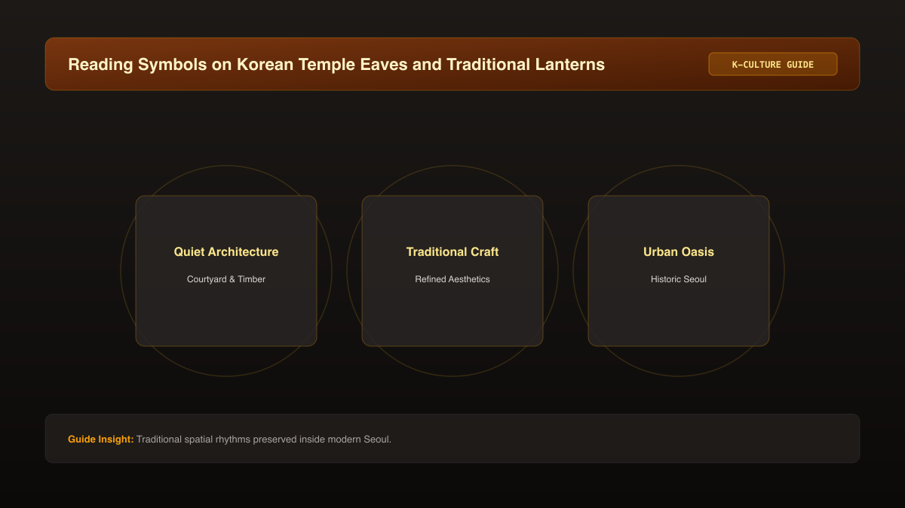

## The Subtle Language of Traditional Spaces

Approaching historic Korean architecture, the eye naturally rises to the sweeping brackets beneath the multi-tiered eaves. Beyond their structural role in supporting heavy tile loads, these architectural junctions carry intentional iconographic motifs passed down through centuries of craftsmanship.

<figure class="explanatory-image">
  
  <figcaption>Figure 1: High-level Korean Traditional Spatial Architecture and Eaves Framing</figcaption>
</figure>

## Key Motifs and Their Meanings

1. **Threshold Dynamics**: Stepping over raised timber sills intentionally slows foot traffic, creating a mental transition from commute to quiet contemplation.
2. **Timber Frame Acoustics**: Natural pine beams and unlacquered eaves soften urban reverb, producing an intimate indoor soundscape.
3. **Seasonal Microclimates**: Deep roof overhangs shield against intense summer sunlight while capturing low winter warmth.

<figure class="explanatory-image">
  
  <figcaption>Figure 2: Courtyard Convection and Eaves Solar Geometry</figcaption>
</figure>

When visiting these historic spaces, take time to notice the deliberate transition from bustling avenue to still courtyard. It represents centuries of refined architectural wisdom in balancing nature with human dwelling.

<figure class="explanatory-image">
  
  <figcaption>Figure 3: Material Craftsmanship and Breathable Timber Matrix</figcaption>
</figure>
