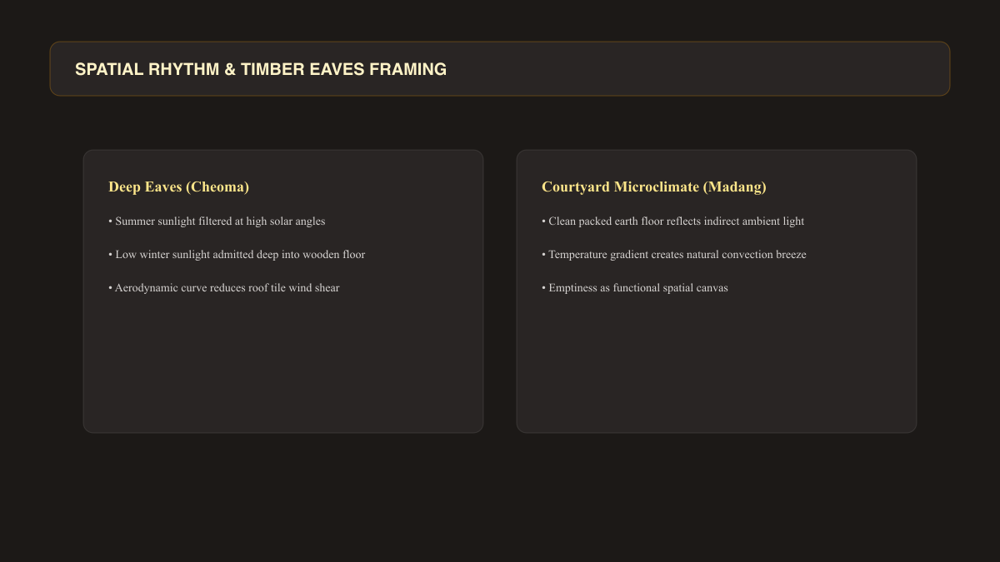
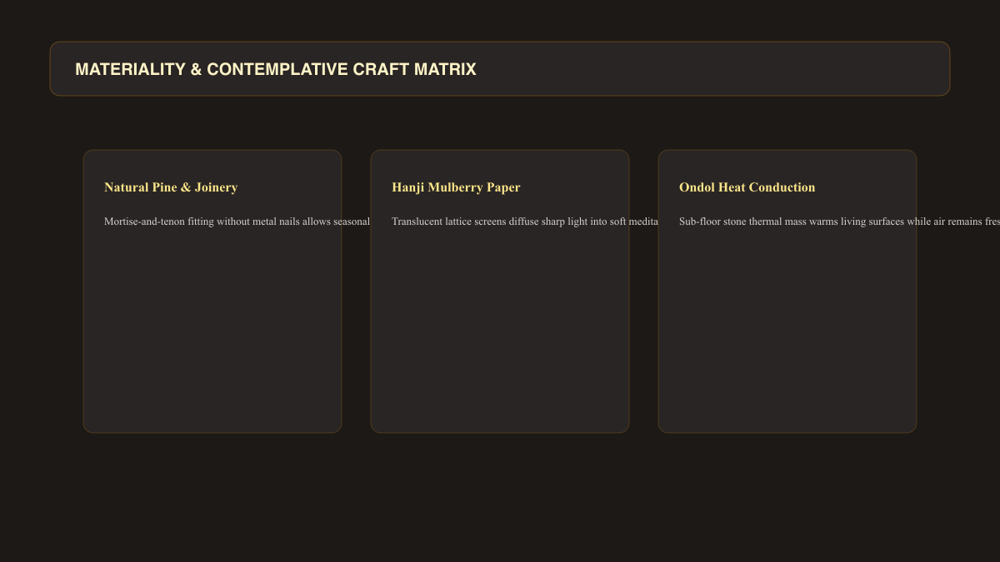

## The Subtle Language of Traditional Spaces

Approaching historic Korean architecture, one immediately notices an unusual architectural departure: chimneys do not protrude from roof ridges as in Western timber cottages. Instead, they stand detached, nestled quietly against terraced rear flower walls (*Kkotdam*) several meters away from the residential quarters.

<figure class="explanatory-image">
  
  <figcaption>Figure 1: High-level Korean Traditional Spatial Architecture and Rear Chimney Placement</figcaption>
</figure>

## Key Motifs and Their Meanings

1. **Subterranean Flue Extension (*Gudeul*)**: By routing the smoke exhaust through gently sloping underground channels into the rear garden, thermal warmth is fully extracted along the floorboards before smoke exits.
2. **Garden Integration as Living Sculpture**: Rather than treating exhaust as an industrial nuisance, artisans sculpted brick and ceramic tiles with auspicious cloud, deer, and pine emblems, turning ventilation into high garden art.
3. **Fire Safety and Draft Control**: Detaching combustion exits from thatched or wooden roof eaves eliminated chimney spark fire risks entirely while dampening abrupt winter downdrafts.

<figure class="explanatory-image">
  
  <figcaption>Figure 2: Subterranean Thermal Draft and Courtyard Microclimate</figcaption>
</figure>

When exploring Korea's royal palaces like Gyeongbokgung's Jagyeongjeon, pause before the freestanding chimneys. They represent an exquisite convergence of thermodynamics, safety engineering, and tranquil landscape aesthetics.

<figure class="explanatory-image">
  
  <figcaption>Figure 3: Material Craftsmanship and Terraced Garden Matrix</figcaption>
</figure>
