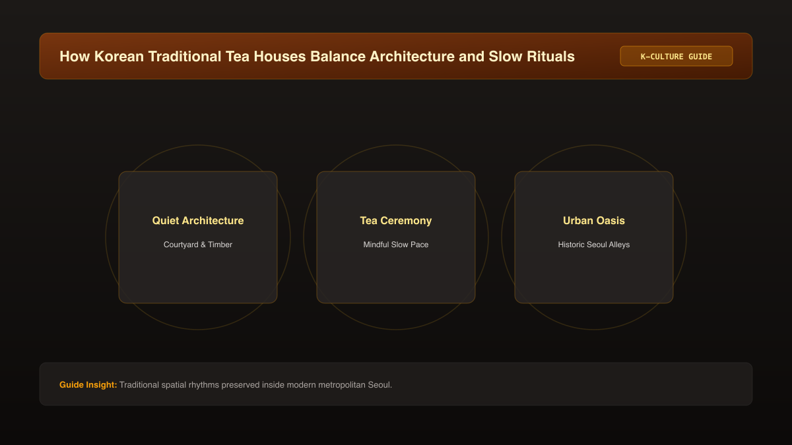

## Reading the Calm Geometry of Traditional Spaces

In the bustling core of modern Seoul, historic neighborhoods hold wooden tea pavilions and tranquil courtyards that operate by an entirely different acoustic and visual rhythm. While exterior streets buzz with automotive speed, stepping through an entryway reveals how traditional woodwork buffers noise and frames natural light.

<figure class="explanatory-image">
  
  <figcaption>AI-generated editorial illustration interpreting traditional Korean spatial flow.</figcaption>
</figure>

## The Architectural Rhythm of Courtyard Buffers

1. **Threshold Dynamics**: Stepping over raised timber sills intentionally slows foot traffic, creating a mental transition from commute to quiet contemplation.
2. **Timber Frame Acoustics**: Natural pine beams and unlacquered eaves soften urban reverb, producing an intimate indoor soundscape.
3. **Seasonal Microclimates**: Deep roof overhangs shield against intense summer sunlight while capturing low winter warmth.

When visiting these historic spaces, take time to notice the deliberate transition from bustling avenue to still courtyard. It represents centuries of refined architectural wisdom in balancing nature with human dwelling.
