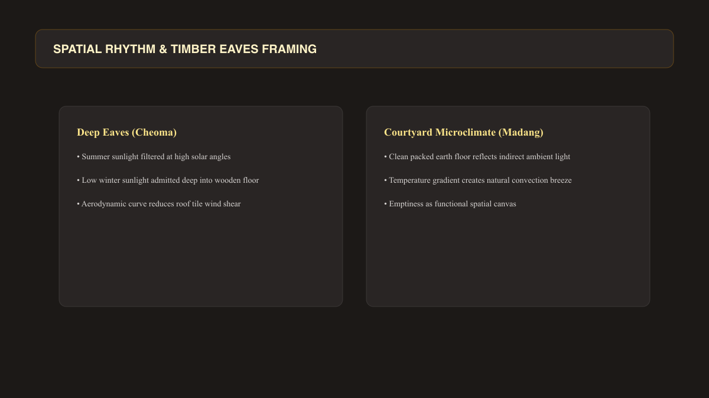

## 1. The Spatial Architecture of Darye: Slowing the Human Pulse

In contemporary Seoul's neon-lit avenues, coffee culture is defined by rapid velocity—grab-and-go espresso counters, plastic cups, and hurried digital workflows. Yet tucked inside the quiet stone-walled alleys of Insadong, Bukchon, and ancient mountain monasteries sits an entirely different spatial universe: the traditional Korean tea house (*chatjip*).

Entering a classical tea space is not merely a gastronomic choice; it is an immediate bodily transition mediated by architecture. The doorway is intentionally low and narrow, requiring visitors to remove their shoes and bend slightly as they cross the raised timber sill. This physical threshold acts as an environmental filter, instantly deadening urban traffic acoustics and encouraging an instinctive lowering of the voice.

In Korean culture, the practice of tea is known as *darye* (다례, 茶禮), literally 'tea etiquette' or 'tea ceremony.' Unlike the rigid, theatrical choreography of Japanese *chanoyu*, Korean *darye* is defined by effortless naturalness (*chayeon*), quiet hospitality, and unpretentious contemplation. This philosophical informality is mirrored directly in the architectural design of the tea pavilion.

<figure class="post-photo">
  
  <figcaption>Figure 1: High-level Korean Traditional Spatial Architecture and Spatial Rhythm. AI-generated editorial illustration by Gemini; not a photograph or primary historical specimen.</figcaption>
</figure>

<!--post-ad-break-->

## 2. Microclimate and Acoustics: Wooden Eaves, Courtyards, and Ambient Sound

Traditional tea rooms are situated to capture subtle acoustic and climatic rhythms. The structure is built of unlacquered Korean red pine, clay walls mixed with straw, and a hand-laid stone foundation. Because natural wood and clay absorb harsh high-frequency reverberations, conversation inside a Hanok tea room takes on an intimate, warm acoustic tone.

The central seating area opens directly toward a compact interior courtyard (*madang*). Often planted with a solitary bamboo grove, mossy granite boulders, and a stone basin catching dripping spring water (*seokjo*), the courtyard acts as a living acoustic backdrop.

The gentle plink of water droplets echoing across the stone floor provides a rhythmic, meditative ambient baseline. During rainy summer afternoons, raindrops striking clay roof tiles (*giwa*) produce a deep, soothing white noise that drowns out the distant hum of the modern metropolis, creating a sanctuary of profound psychological stillness.

<figure class="post-photo">
  
  <figcaption>Figure 2: Eaves Solar Geometry and Courtyard Thermal Convection Loop. AI-generated architectural illustration by Gemini; conceptual diagram of environmental principles.</figcaption>
</figure>

## 3. Material Warmth: Low Soban Tables, Ondol Floors, and Celadon Bowls

Sitting cross-legged upon a warm *ondol* floor covered in natural hemp mats (*motseok*) or oiled mulberry paper (*jangpan*), the guest's eye level rests approximately two feet above the ground. At this height, furniture ceases to dominate space.

Tea is prepared upon low carved wooden tables (*dasan* or *soban*) crafted from native zelkova or persimmon wood. The tea master (*chajang*) arranges ceramic implements with relaxed precision:
1. **The Cooling Bowl (*Suksul-woo*)**: A broad-lipped ceramic bowl where boiling water is poured first to cool to roughly 70 degrees Celsius before steeping delicate green tea leaves.
2. **The Ceramic Teapot (*Daho*)**: Often fired from coarse regional stoneware, retaining steady brewing warmth without burning the hand.
3. **The Tea Cups (*Chajan*)**: Broad, shallow ceramic cups that fit comfortably in both hands, encouraging the drinker to cradle the vessel and absorb its warmth before taking the first sip.

Holding a warm stoneware cup with both hands while seated upon a heated floor creates a complete sensorial circuit of physical relaxation that melts muscular tension within minutes.

<figure class="post-photo">
  
  <figcaption>Figure 3: Material Craftsmanship, Interlocking Timber Joinery, and Organic Materiality. AI-generated illustration by Gemini; visual study of traditional craft principles.</figcaption>
</figure>

## 4. The Art of Borrowed Scenery (Chagyeong) in Intimate Tea Spaces

One of the greatest joys of visiting a traditional tea pavilion is the framing of nature. The window lattice (*changho*) is lined with translucent white *hanji* paper, filtering harsh exterior sunlight into a soft, pearl-like ambient glow.

During warm afternoons, the sliding lattice screens are lifted and hooked to the rafters, dissolving the exterior wall completely. The open portal acts as a living picture frame that 'borrows' the adjacent stone lantern, moss-covered garden wall, and mountain silhouettes into the tea room—the timeless aesthetic of *chagyeong*.

The tea drinker does not gaze upon an artificial landscape painting; nature itself enters the room. A stray autumn breeze rustles the tea master's linen sleeves, carrying the scent of damp moss and woodsmoke from the rear garden stove into the tea bowl.

## 5. Practical Field Guide: Appreciating Historic Korean Tea Houses

When exploring traditional tea enclaves in Seoul or visiting historic monastery tea rooms, follow this visitor etiquette guide:

1. **Step In Slowly and Remove Shoes Completely**: Place your shoes neatly facing outward toward the courtyard, honoring the cleanliness of the papered floor.
2. **Hold the Cup with Both Hands**: In Korean tradition, hold the cup body with your right hand while lightly supporting the base foot with your left fingertips. This two-handed posture expresses gratitude and keeps your posture centered.
3. **Listen Before You Drink**: Pay attention to the three primary sounds of the tea room: the bubbling of water in the cast-iron kettle (*tangsu*), the rhythmic pouring of tea into the cups, and the gentle wind passing through the courtyard bamboo.
