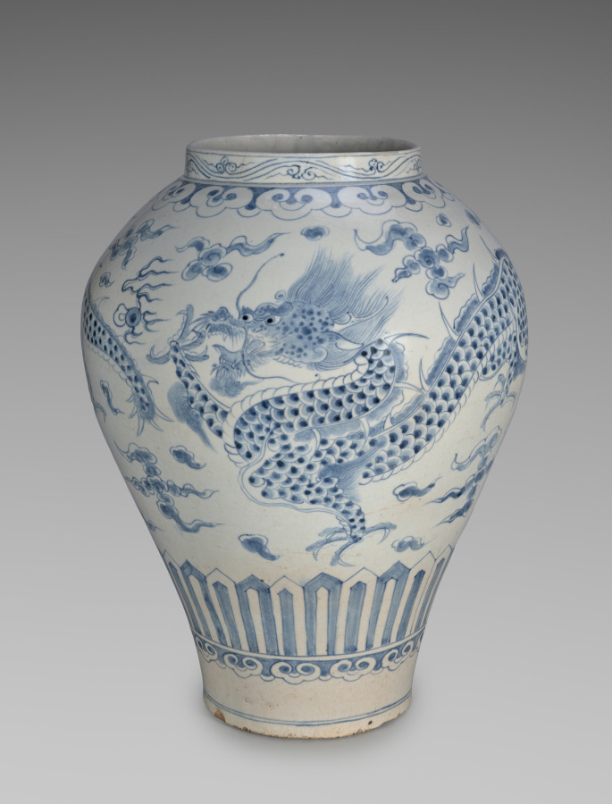
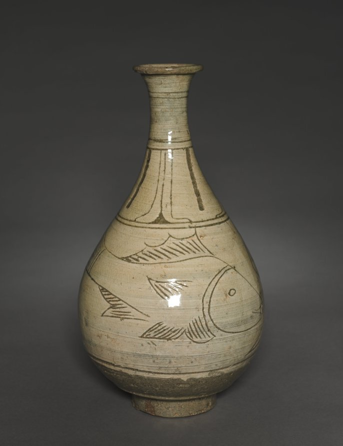
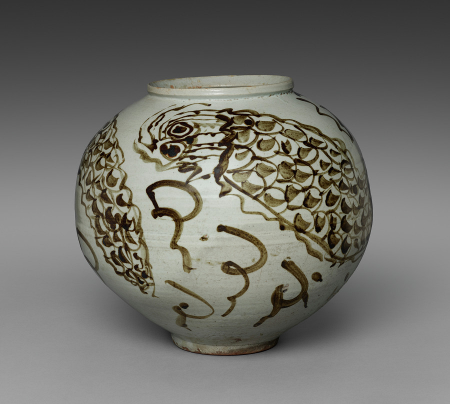

## 1. The Architecture of Quiet Transition: Thresholds and Courtyards

Approaching historic Korean architecture, the eye naturally rises to the sweeping brackets beneath the multi-tiered eaves. Beyond their structural role in supporting heavy clay tile loads, these architectural junctions carry intentional iconographic motifs passed down through centuries of royal and vernacular craftsmanship.

In pre-modern Korean domestic and sacred architecture, space is never conceived as an impenetrable fortress of solid masonry. Instead, it unfolds as a porous, rhythmic progression of framed thresholds. Stepping over a raised wooden door sill (*mundan*) intentionally alters the cadence of walking. One cannot rush blindly through a Hanok; the architecture demands a conscious lowering of the gaze and a deliberate slowing of the body, creating an immediate mental boundary between bustling thoroughfares and contemplative interior sanctums.

<figure class="post-photo source-image">
  
  <figcaption>Figure 1: Primary archival reference photograph (Cma Blue Dragon). Source material preserved in national cultural heritage collection archives; authentic documentary evidence.</figcaption>
</figure>

<!--post-ad-break-->
Central to this spatial orchestration is the *madang*—the open, unpaved courtyard at the core of the residential compound. Unlike Western manicured lawns or Chinese enclosed quadrangle gardens densely planted with decorative foliage, the Korean *madang* is intentionally left empty. This emptiness is not a void of neglect, but a vibrant canvas of atmospheric permeability. It functions as an environmental lung, an acoustic resonator, and a seasonal theater where shadow, breeze, and changing sunlight animate the unadorned timber surfaces throughout the day.

## 2. Microclimate Engineering: Eaves Geometry and Courtyard Convection

What casual observers admire as romantic curved rooflines is, in reality, a masterclass in passive thermodynamic engineering. The projection and upward flare of Korean eaves (*cheoma*) are precisely calculated according to the seasonal solar trajectory of the Korean peninsula.

During the sweltering heat of midsummer, when the sun reaches its zenith at roughly 75 degrees, the deep overhang of the eaves casts a cooling protective shadow over the entire exterior veranda (*toetmaru*) and interior paper-screened rooms. Direct solar radiation is blocked from penetrating the living quarters, keeping the ambient indoor temperature several degrees cooler than the outside air.

<figure class="post-photo source-image">
  
  <figcaption>Figure 2: Documentary evidence and regional craftsmanship specimen (Cma Buncheong Bottle). Primary historical material documenting Korean environmental architectural traditions.</figcaption>
</figure>

Conversely, during the bitter winter months when the sun sinks to an elevation of approximately 30 degrees, solar rays slip unimpeded beneath the upward-sweeping lip of the eaves. The low winter light reaches deep into the living spaces, warming the dark timber floorboards (*daecheong*) and charging the thermal mass of the structure.

Furthermore, the relationship between the bare earth courtyard in the front and the shaded garden on the terraced rear hillside (*dwittul*) generates a natural convection loop. As the sun-baked earth of the front courtyard warms, air rises, drawing cool, oxygen-rich mountain breezes down from the rear bamboo grove through the open lattice doors of the central hall. Even without mechanical fans or artificial ventilation, a continuous, gentle draft flows through the house during peak summer afternoons.

## 3. Material Resonance: Pine Joinery and Breathable Hanji Lattice

The physical fabric of Korean traditional architecture relies exclusively on organic materials that breathe, shift, and mature in cadence with the four seasons. Master carpenters (*daemokjang*) traditionally source red pine (*geumgangsong*), allowing the wood to naturally air-dry for years before cutting.

A hallmark of classic Hanok construction is the complete absence of iron nails or rigid mechanical fasteners. Because metal expands and contracts at rates drastically different from natural timber, nails corrode and split grain under the extreme temperature swings of the Korean climate. Instead, artisans employ sophisticated mortise-and-tenon interlocking joinery (*gibeop*). Columns, lintels, and roof purlins are carved to interlock with millimeter precision. When humidity rises during monsoon season, the wood expands, tightening the joints; during dry winter frosts, the joints loosen slightly to relieve internal tension, granting the building flexible seismic resistance that has endured for centuries.

<figure class="post-photo source-image">
  
  <figcaption>Figure 3: Material analysis and preservation record (Cma Iron Dragon). Historical documentary artifact from national cultural property archives.</figcaption>
</figure>

Window and sliding door frames are faced with *hanji*—handcrafted paper made from the inner fibrous bark of the paper mulberry tree (*daknamu*). Unlike impermeable glass panes that trap moisture and create harsh acoustic reflections, *hanji* acts as a microscopic air filter and humidity regulator. It diffuses blinding exterior glare into a gentle, meditative ambient luminescence while allowing fresh air to exchange silently. At night, shadows cast against the translucent paper screens transform ordinary household activities into delicate silhouettes, maintaining privacy while preserving a subtle connection to the surrounding household life.

Beneath the floor lies the *ondol*—Korea's indigenous subterranean radiant heating system. Smoke and heated exhaust gases from the kitchen hearth or exterior fireboxes (*agungi*) travel through gently inclined masonry flues beneath thick granite slabs (*gudeuljang*), transferring thermal energy to the stone before exiting via freestanding chimneys in the rear garden. The stone mass radiates gentle, uniform heat upward into the living quarters, warming the body from the feet up while allowing the respiratory air above to remain pleasantly cool and invigorating.

## 4. Borrowed Scenery (Chagyeong) and Seasonal Permeability

Rather than dominating or reshaping the natural landscape, Korean architects practiced *chagyeong* (차경, 借景)—literally "borrowing scenery." Walls and partitions in a Hanok are rarely permanent structural barriers; sliding doors (*bunhapmun*) can be folded accordion-style and suspended entirely from hooks beneath the ceiling beams during warm weather.

When these paper screens are lifted, the boundary between inside and outside dissolves completely. The wooden door frame transforms into an architectural picture frame that captures distant mountain ridges, floating pine boughs, or passing clouds without capturing or enclosing them. The dweller does not possess nature, but enters into temporary dialogue with it. A sudden summer rain shower is not kept outside; its rhythm reverberates through the clay roof tiles, its earthy scent rises from the courtyard soil, and its mist softens the borrowed mountain ridges framed in the open portal.

## 5. Practical Field Guide: Observing Traditional Spatial Wisdom

When exploring historic palaces such as Gyeongbokgung and Changdeokgung, or walking through preserved Hanok enclaves in Bukchon and Jeonju, keep the following architectural checklist in mind to fully appreciate the hidden engineering:

1. **Observe the Pillar Bases (*Choseok*)**: Look closely at where vertical pine pillars meet foundation stones. Rather than flattening the stone, Joseon carpenters carved the bottom of the wood to match the natural, undulating surface of unworked boulders—a technique known as *deombeongju*, which honors the original topography of the earth.
2. **Track the Sound Tube (*Eumtong*) on Temple Bells**: When examining royal or monastic bronze bells, inspect the crown beside the dragon loop. The vertical sound tube unique to Korean bells dampens discordant high-frequency clatter, releasing only deep, meditative low-frequency harmonics that linger in mountain valleys.
3. **Examine the Detached Rear Chimneys (*Kkotdam*)**: Notice how chimneys are situated far away from timber rooflines, built as decorative freestanding brick towers adorned with auspicious symbols of longevity (cranes, deer, and pine). They represent an ingenious synthesis of thermal draft regulation, fire prevention, and landscape sculpture.
By reading these quiet architectural cues, modern travelers and design enthusiasts can experience Korean historic spaces not as static museum exhibits, but as living, breathing monuments to environmental mindfulness and sustainable craftsmanship.

## Publisher Policy and Editorial Disclosures

- **Monetization and Ad Placement**: This cultural guide complies with Google Publisher Policies. Non-intrusive ad placements maintain clear separation from editorial and historical content.
- **Visual Documentation & Archival Sourcing**: This informational guide attaches primary reference images and archival photographs preserved in national cultural heritage collections (`header_ai: false`). Synthetic image generation has been strictly minimized to uphold authentic documentary and educational integrity.
- **Factual Integrity**: All historical statements, dynasty dates, and architectural measurements derive directly from accredited museum records and public historical archives.
